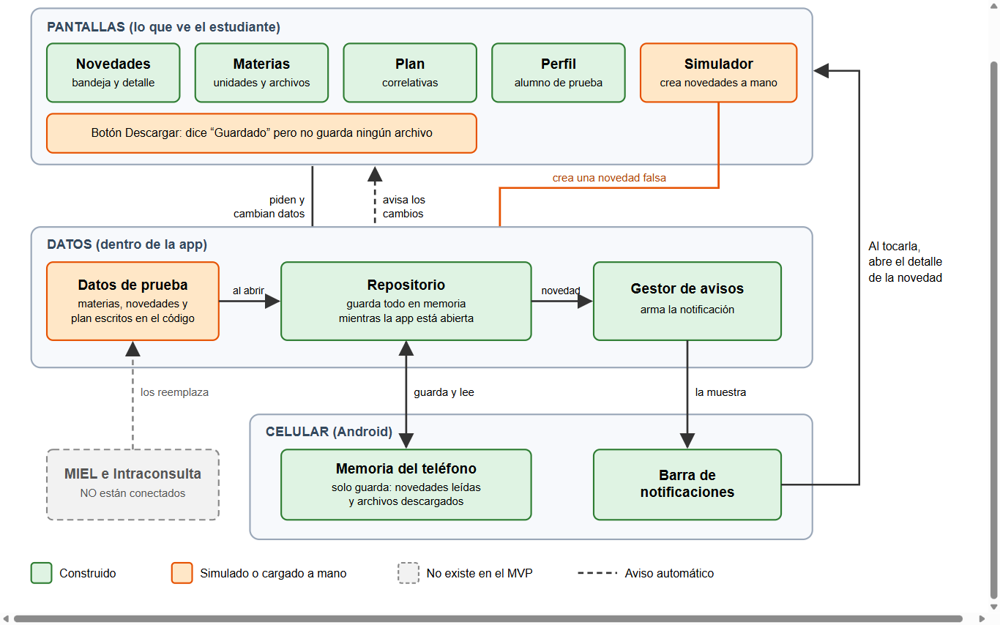
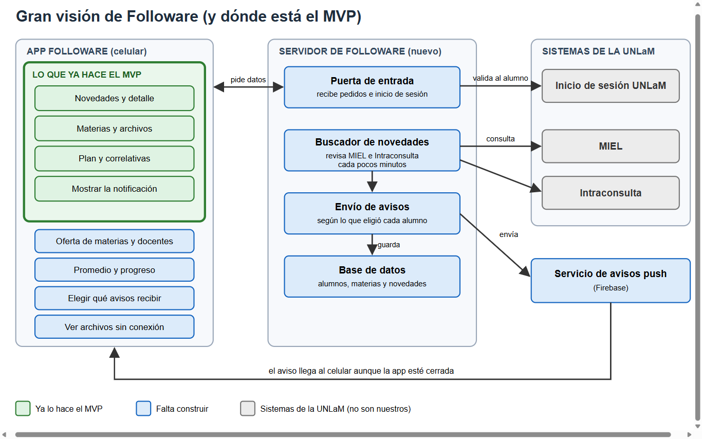

# Brief de Producto

## Versión 6 — TP6 (10/11/2026)

**Qué cambió respecto de la versión anterior y por qué:** Como la prueba del TP5 sostuvo la hipótesis, el foco pasa de *qué* construir a *cómo* hacer crecer el producto. Por eso agregamos la arquitectura: cómo está armado hoy el MVP (una app Android que funciona sola, sin servidor y con datos de prueba), las decisiones que heredamos al construirlo con IA, cómo sería el producto completo (un servidor propio que se conecta con MIEL e Intraconsulta y manda avisos aunque la app esté cerrada), las restricciones técnicas de la UNLaM, las tecnologías nuevas que hacen falta y la parte con más riesgo: la conexión con MIEL.

---

## 1. Segmento elegido

**Segmento:** son estudiantes regulares de la UNLaM que se encuentran actualmente cursando materias, independientemente de la carrera a la que pertenezcan siendo esta una carrera de grado.

**Tamaño estimado:** aproximadamente 80.000 estudiantes de la UNLaM.

**Qué los distingue del resto:**

Los estudiantes que actualmente cursan materias necesitan consultar frecuentemente información relacionada con su trayectoria académica y sus cursadas, como materias aprobadas y pendientes, promedio, materias en curso, comisiones, horarios y novedades.

Además, utilizan diferentes sistemas de la universidad para gestionar distintos aspectos de su vida académica. Principalmente utilizan **Intraconsulta** para consultar información relacionada con su carrera y **MIEL** para acceder a contenidos, comunicaciones y novedades de las materias.

**Por qué elegimos este segmento:**

* Es el grupo que experimenta directamente el problema que Followare busca resolver.
* Necesita consultar información académica que actualmente se encuentra distribuida entre diferentes plataformas.
* Realiza un seguimiento continuo tanto de su progreso académico como de las materias que está cursando.
* El equipo tiene acceso a estudiantes reales pertenecientes a este segmento para realizar el relevamiento y posteriormente probar el MVP.

---

## 2. Producto

**Nombre:** Followare.

**Descripción:** Followare es una aplicación asistente para estudiantes de la UNLaM que centraliza información académica proveniente de MIEL e Intraconsulta y permite realizar un seguimiento del progreso de la carrera.

### Problema que resuelve

Los estudiantes deben utilizar diferentes sistemas para consultar información relacionada con su carrera y sus materias. Esto dificulta tener una visión centralizada de su progreso académico y mantenerse al tanto de las novedades de sus cursadas.

Followare busca centralizar esta información y facilitar el seguimiento de las materias en curso mediante notificaciones sobre nuevos mensajes, materiales, avisos y publicaciones.

### Funcionalidades principales

* **Seguimiento del progreso académico:** consulta de materias aprobadas y pendientes, avance de la carrera y promedio.
* **Consulta de oferta académica:** consulta de materias, comisiones, horarios y cátedras disponibles.
* **Consulta de materias en curso:** acceso a novedades, materiales y comunicaciones de las materias.
* **Notificaciones:** avisos sobre nuevos mensajes, materiales y publicaciones de las materias.
* **Centralización de información:** consulta desde una misma aplicación de información proveniente de Intraconsulta y MIEL.

---

## 3. Integraciones

Followare requiere integrarse con **Intraconsulta y MIEL**, ya que ambos sistemas contienen información necesaria para las funcionalidades principales del producto.

**Intraconsulta:** permitiría obtener información relacionada con la trayectoria académica y la oferta de materias, como materias aprobadas, pendientes y comisiones disponibles.

**MIEL:** permitiría obtener información relacionada con las materias que el estudiante está cursando, como mensajes, materiales y publicaciones.

La implementación concreta de estas integraciones dependerá de los mecanismos de acceso que permitan los sistemas institucionales.

---

## 4. Grupos de usuarios

### Usuario primario

**Estudiantes de grado que actualmente se encuentran cursando materias.**

Son los principales usuarios de Followare porque experimentan directamente el problema que el producto busca resolver. Se benefician principalmente de la centralización de información académica, el seguimiento de su carrera y las notificaciones de las materias en curso.

### Usuarios secundarios

**Docentes:** están relacionados con el funcionamiento de las materias y utilizan MIEL para publicar materiales, mensajes, avisos y otras comunicaciones destinadas a los estudiantes.

Los docentes no forman parte del segmento principal seleccionado para este TP, ya que las funcionalidades principales de Followare están orientadas a las necesidades de los estudiantes.

---

## 5. Acceso a usuarios

Se identificaron tres usuarios reales pertenecientes al segmento seleccionado:

* **U1:** estudiante de Kinesiología que actualmente cursa materias. Persona conocida en la facultad. Disponible para el relevamiento del TP2 y para la prueba del MVP del TP5.
* **U2:** estudiante de Trabajo Social que actualmente cursa materias. Persona conocida en la facultad. Disponible para el relevamiento del TP2 y para la prueba del MVP del TP5.
* **U3:** estudiante de Contabilidad que actualmente cursa materias. Persona conocida en la facultad. Disponible para el relevamiento del TP2 y para la prueba del MVP del TP5.

---

## 6. Supuestos

* **Asumimos que los estudiantes tienen dificultades para consultar información académica porque deben utilizar diferentes sistemas de la universidad.**
  **Evidencia:** los usuarios mencionan que deben ingresar a MIEL e Intraconsulta para consultar información diferente.

* **Asumimos que los estudiantes necesitan consultar con frecuencia su progreso académico.**
  **Evidencia:** los usuarios afirman que consultan regularmente sus materias aprobadas, pendientes y promedio.

* **Asumimos que los estudiantes quieren conocer de manera sencilla qué materias les faltan para completar su carrera.**
  **Evidencia:** los usuarios manifiestan interés en conocer rápidamente las materias que tienen pendientes.

* **Asumimos que los estudiantes tienen dificultades para mantenerse al tanto de las novedades publicadas en MIEL.**
  **Evidencia:** los usuarios indican que alguna vez no vieron a tiempo una publicación o aviso de una materia.

* **Asumimos que recibir notificaciones sobre nuevas publicaciones o materiales sería útil para los estudiantes.**
  **Evidencia:** los usuarios consideran útil recibir avisos cuando hay novedades en sus materias.

* **Asumimos que los estudiantes consideran útil tener en un mismo lugar la información de MIEL e Intraconsulta.**
  **Evidencia:** los usuarios prefieren consultar la información académica desde una única aplicación.

* **Asumimos que los estudiantes utilizarían Followare de manera recurrente durante el cuatrimestre.**
  **Evidencia:** los usuarios manifiestan que utilizarían la aplicación varias veces durante la cursada.

* **Supuesto crítico:**
  **Asumimos que los estudiantes consideran un problema tener la información académica distribuida entre diferentes sistemas.**
  **Evidencia:** los usuarios manifiestan que les resulta incómodo consultar información en diferentes plataformas y que preferirían tenerla centralizada.

---

## 7. Perfil del Usuario Real

A partir de las respuestas obtenidas, el usuario primario de Followare está representado por estudiantes de distintas carreras de grado de la UNLaM que actualmente se encuentran cursando materias y utilizan habitualmente herramientas tecnológicas. Los tres usuarios analizados presentan una relación avanzada con la tecnología y utilizan MIEL varias veces durante el día. Esto demuestra que el acceso a una aplicación digital no representa una barrera importante para este grupo.

La encuesta recibió un total de cinco respuestas. Se decidió relevar a más de tres estudiantes con el objetivo de obtener una visión más general del problema que se busca solucionar y conocer diferentes experiencias y necesidades. Para el análisis del grupo de usuarios primario, se seleccionaron tres respuestas correspondientes a estudiantes de Contador Público, Trabajo Social y Kinesiología, identificados como U1, U2 y U3. Las otras dos respuestas no fueron incorporadas al análisis, ya que no correspondían a los perfiles de usuarios seleccionados para este relevamiento.

Sin embargo, existen diferencias según el momento de la carrera. El usuario de Contador Público se encuentra en cuarto año y tiene necesidades relacionadas con la organización y planificación de una trayectoria académica más avanzada, mientras que los usuarios de Trabajo Social y Kinesiología se encuentran en primer año y todavía están familiarizándose con la organización de la carrera.

---

## 8. Necesidades reales

**Centralizar información académica**

Los usuarios consultan información en diferentes sistemas y consideran útil, aunque con distintos matices, contar con un lugar que facilite el acceso a la información universitaria. El usuario de Contador Público considera que una solución unificada podría ayudar a mejorar la organización. El usuario de Kinesiología también considera útil evitar tener que ingresar separadamente a distintas plataformas.

Sin embargo, el usuario de Trabajo Social plantea una diferencia importante: considera que la información administrativa y la académica deberían mantenerse separadas. Este resultado no implica necesariamente que la información deba permanecer en plataformas diferentes, sino que una plataforma unificada podría organizar la información en perfiles o secciones diferenciadas, por ejemplo, un perfil académico para consultar materias, cursadas, notas y progreso, y un perfil administrativo para realizar trámites y consultar información relacionada. De esta manera, Followare podría centralizar el acceso sin mezclar distintos tipos de información.

**Recibir información importante de manera oportuna**

Los tres usuarios manifestaron haber recibido tarde alguna información de MIEL. Los tipos de información que consideran útiles para recibir mediante notificaciones incluyen: mensajes de profesores, nuevos materiales, cambios de aula, cambios en la modalidad de cursada, avisos inesperados, fechas de inscripción, recordatorios de evaluaciones y materiales necesarios para próximas clases. El usuario de Contador Público fue particularmente específico respecto de la necesidad de anticiparse a cambios inesperados, como modificaciones de aulas o modalidad de cursada.

**Conocer información de las materias antes de inscribirse**

Los usuarios utilizan principalmente Intraconsulta para consultar horarios y comisiones. En cuanto a los profesores, ninguno de los tres usuarios manifestó conocer siempre de antemano qué docente estará en cada comisión. Los usuarios de Trabajo Social y Kinesiología indicaron que generalmente se enteran del profesor cuando comienzan las clases.

El usuario de Contador Público como alumno de 4to año, considera muy importante conocer al profesor antes de inscribirse y utiliza recomendaciones de compañeros para conocer quién dicta cada comisión. Esto permite identificar una posible necesidad relacionada con la información previa a la inscripción.

---

## 9. Problemas y frustraciones concretas

**La información está distribuida entre diferentes sistemas**

Los estudiantes deben utilizar MIEL e Intraconsulta para consultar diferentes tipos de información. Esto genera la necesidad de recordar qué información se encuentra en cada plataforma y acceder a ellas por separado.

**Los estudiantes pueden enterarse tarde de información importante**

Los tres usuarios respondieron que alguna vez se enteraron tarde de un mensaje, aviso o material publicado en MIEL. Por lo tanto, el problema de las novedades no consiste simplemente en no tener acceso a la información, sino en no enterarse oportunamente de que existe nueva información.

**No siempre se conoce al profesor antes de elegir una comisión**

Los usuarios de Trabajo Social y Kinesiología indicaron que generalmente conocen al profesor cuando comienzan las clases. Esto contrasta con el usuario de Contador Público, que considera fundamental conocer al profesor antes de inscribirse y actualmente utiliza recomendaciones de otros estudiantes para obtener esa información.

**El cálculo del promedio no es una necesidad prioritaria para todos**

Un resultado interesante es que los tres usuarios no demostraron una necesidad fuerte de calcular constantemente su promedio. El usuario de Contador Público y los usuarios de Trabajo Social y Kinesiología indicaron que no suelen consultar su promedio. Por lo tanto, aunque Followare puede incluir esta funcionalidad, el relevamiento indica que no debería considerarse necesariamente la principal propuesta de valor.

---

## 10. Contexto de uso

Los estudiantes utilizan MIEL principalmente durante el día y varias veces.

  * U1 ingresa entre 1 y 5 veces por día.

  * U2 ingresa aproximadamente 2 o 3 veces por día.

  * U3 ingresa aproximadamente 3 veces por día.

Los principales motivos de ingreso son consultar mensajes o avisos, descargar materiales y consultar fechas o información de las materias. En el caso de U2 también se utiliza para entregar trabajos o actividades.

Por lo tanto, Followare sería utilizado principalmente durante el día y a lo largo de la cursada, especialmente cuando el estudiante necesita verificar si existen novedades, consultar información de una materia o revisar fechas.

El relevamiento también muestra que el uso de MIEL es recurrente, por lo que una funcionalidad de notificaciones podría reducir la necesidad de ingresar únicamente para comprobar si existe alguna novedad.

---

## 11. Hipótesis de valor

Creemos que los estudiantes de la UNLaM que actualmente cursan materias tienen el problema de que deben consultar diferentes plataformas y pueden enterarse tarde de información importante de sus materias.

Nuestra solución es Followare, una aplicación que centraliza y facilita el acceso a información académica de MIEL e Intraconsulta y envía notificaciones sobre novedades relevantes, materiales, mensajes y fechas.

Sabremos que estamos en lo correcto si, durante la prueba del MVP, al menos 2 de los 3 estudiantes indican que Followare les facilita el acceso a la información de sus materias y consideran útiles las notificaciones de novedades. Se establece este criterio tomando como referencia que el relevamiento inicial fue realizado con 3 usuarios.

---

## 12. Estado de supuestos

**1. Asumimos que los estudiantes tienen dificultades para consultar información académica porque deben utilizar diferentes sistemas de la universidad.**
  **Estado:** Confirmado.
  **Evidencia:** Los usuarios utilizan MIEL e Intraconsulta para acceder a diferentes tipos de información. Sin embargo, U2 considera que podría ser mejor mantener separada la información administrativa de la académica.

**2. Asumimos que los estudiantes necesitan consultar con frecuencia su progreso académico.**
  **Estado:** Refutado.
  **Evidencia:** Los tres usuarios indicaron que no suelen consultar su promedio. Esto muestra que el seguimiento del progreso académico no aparece como una necesidad frecuente para estos usuarios.

**3. Asumimos que los estudiantes quieren conocer de manera sencilla qué materias les faltan para completar su carrera.**
  **Estado:** Sin evidencia.
  **Evidencia:** La encuesta no preguntó directamente con qué frecuencia consultan las materias pendientes ni si consideran problemática esta tarea.

**4. Asumimos que los estudiantes tienen dificultades para mantenerse al tanto de las novedades publicadas en MIEL.**
  **Estado:** Confirmado.
  **Evidencia:** Los tres usuarios indicaron que alguna vez se enteraron tarde de un mensaje, aviso o material publicado en MIEL.

**5. Asumimos que recibir notificaciones sobre nuevas publicaciones o materiales sería útil para los estudiantes.**
  **Estado:** Confirmado.
  **Evidencia:** Los usuarios manifestaron interés en recibir notificaciones de mensajes, materiales, cambios, recordatorios y otras novedades.

**6. Asumimos que los estudiantes consideran útil tener en un mismo lugar la información de MIEL e Intraconsulta.**
  **Estado:** Confirmado.
  **Evidencia:** U1 y U3 consideran útil centralizar o facilitar el acceso. Pero, por otro lado, U2 prefiere separar la información administrativa de la académica. (Confirmamos el supuesto ya que 2 de 3 encuestados consideran útil centralizar las plataformas)

**7. Asumimos que los estudiantes utilizarían Followare de manera recurrente durante el cuatrimestre.**
  **Estado:** Confirmado.
  **Evidencia:** Los tres usuarios utilizan MIEL varias veces al día y tienen necesidades recurrentes relacionadas con mensajes, materiales y fechas. Esto respalda un uso frecuente de una solución como Followare.

**Supuesto crítico: Asumimos que los estudiantes consideran un problema tener la información académica distribuida entre diferentes sistemas.**
  **Estado:** Confirmado
  **Evidencia:** Los usuarios utilizan MIEL e Intraconsulta para consultar información diferente y consideran útil facilitar el acceso a ella. Sin embargo, el usuario de Trabajo Social plantea que la información académica y administrativa debería mantenerse diferenciada, por lo que la necesidad parece estar más relacionada con facilitar y organizar el acceso a la información.

## 13. Scope del MVP

| Incluido en el MVP | Para qué parte de la hipótesis sirve |
|---|---|
| Notificaciones (MIEL + Intraconsulta) | Para obtener notificaciones sobre novedades relevantes, materiales, mensajes y fechas |
| Materias en curso + Contenidos | Para facilitar el acceso a la información de las materias |
| Correlatividades | Para centralizar el acceso a la información académica |

| Excluido del MVP | Por qué se excluye |
|---|---|
| Cálculo de promedio | Teniendo en cuenta los resultados de las encuestas, no vemos que sea una funcionalidad importante para los estudiantes |
| Docentes – Funcionalidad completa | Son usuarios secundarios que no son necesarios para el MVP, ya que solo aparecen desde un rol de apoyo |
| Trámites generales (ej.: solicitud de constancia de examen) | Se excluyen porque corresponden a información administrativa y no son necesarias para probar la hipótesis de valor del MVP, centrada en la información académica de las materias en curso y sus novedades. |
| Oferta de materias | No es necesaria para probar la hipótesis de valor del MVP, que se centra principalmente en facilitar el acceso a la información de las materias en curso y recibir oportunamente sus novedades. |

### Qué se construye y qué se simula 

| Elemento | Se construye | Se simula / se resuelve a mano | Por qué |
|---|---|---|---|
| Notificaciones | Sí | Se simula: La generación y llegada de las notificaciones  | Permite probar si el usuario encuentra útil recibir novedades sin necesidad de implementar todavía la integración real con MIEL e Intraconsulta.|
| Materias en curso | Sí | Se resuelve a mano: Carga inicial de las materias | Se cargará previamente un conjunto de materias para que el usuario pueda probar el flujo del MVP|
| Contenidos | Sí | Se resuelve a mano: Carga de contenidos| Para asi el alumno al entrar una materia vea contenido y pueda descargarlo |
| Correlatividades | Sí | Se resuelve a mano: Datos provenientes de Intraconsulta  | Permite simular la integración con Intraconsulta sin desarrollar la integración real durante el MVP. |

### Flujo principal del MVP

El flujo principal se centra en la recepción y consulta de una notificación, ya que este flujo permite probar directamente si Followare facilita el acceso oportuno a información relevante de las materias: 

1. El usuario recibe una notificación (puede ser por un mensaje de algún profesor, carga de material, carga de fecha relevante o alguna otra novedad).
2. El usuario accede a la aplicación.
3. El usuario visualiza el contenido de la notificación.
4. El usuario cierra la notificacion y visualiza las materias en curso

Tomando los demás elementos del MVP vemos otros flujos menos importantes, pero creemos que aportan valor al usuario.

### Atributos de usabilidad

* **Satisfacción:** se prioriza porque los tres usuarios manifestaron haber recibido tarde información importante de MIEL y expresaron interés en recibir notificaciones sobre mensajes, materiales, cambios y otras novedades. Una experiencia que permita enterarse de estas novedades puede reducir la frustración asociada a perder información importante. 
* **Eficiencia:** se prioriza porque los usuarios consultan MIEL varias veces durante el día para revisar mensajes, materiales y fechas. Además, deben ingresar a diferentes sistemas para consultar información académica, por lo que reducir la cantidad de pasos y accesos necesarios resulta especialmente relevante.

### Fundamentación de las decisiones

### Anclaje

Las principales decisiones tomadas en el diseño del wireframe se basaron en los resultados obtenidos durante el relevamiento realizado en el TP2.

#### Decisión 1 — Bandeja de novedades como elemento central del flujo

Se decidió priorizar las notificaciones dentro del flujo principal porque los usuarios manifestaron que utilizan MIEL con frecuencia para consultar novedades e información de sus materias. Por ejemplo, ante la pregunta sobre la frecuencia de uso, uno de los usuarios respondió **“2 o 3 veces en el dia”**, mientras que otro indicó **“Entre 1 y 5 veces, para verificar novedades o consultar material bibliografico.”**

Además, al consultar para qué utilizaban MIEL, se mencionaron actividades como **“Ver si hay nuevos mensajes o avisos., Descargar materiales., Consultar fechas o información de las materias.”**

Estos resultados respaldan la decisión de que Followare permita acceder rápidamente a las novedades y contenidos relevantes, evitando pasos innecesarios.

#### Decisión 2 — Acceso directo al contenido desde la notificación

La alternativa B fue diseñada buscando reducir la cantidad de pasos necesarios para consultar una novedad. Esta decisión se relaciona con el uso frecuente que los usuarios hacen de MIEL y con la necesidad de consultar rápidamente mensajes, materiales y fechas.

Esta decisión se fundamenta en que uno de los usuarios manifestó: **“Sí, varias veces me entre tarde de mensajes”**.

Además, los usuarios utilizan MIEL varias veces durante el día, por lo que consideramos importante que el acceso a una novedad requiera la menor cantidad posible de pasos.

#### Decisión 3 — Agrupamiento de las novedades por materia

El wireframe organiza las novedades vinculándolas con las materias en curso. Esta decisión busca facilitar la organización de la información académica, ya que los estudiantes actualmente deben utilizar diferentes sistemas para acceder a distintos tipos de información.

El TP2 identificó como problema concreto que los estudiantes deben ingresar a MIEL e Intraconsulta por separado.

---

### Descarte

#### Rechazo 1 — Alternativa A: navegación paso a paso

Claude propuso una alternativa centrada en la **facilidad de aprendizaje**, con onboarding de tres pantallas, breadcrumb, una acción principal por pantalla y una navegación más guiada.

El equipo decidió no utilizar esta alternativa porque el relevamiento mostró que los tres usuarios tienen una relación avanzada con la tecnología y utilizan MIEL varias veces durante el día. Por lo tanto, consideramos que agregar pasos y acompañamiento para facilitar el primer uso no responde al principal problema detectado.

En su lugar, se eligió la **Alternativa B**, que reduce la cantidad de pasos y prioriza la eficiencia.

#### Rechazo 2 — Alternativa C: confirmaciones y mayor control

Claude propuso una alternativa orientada a la satisfacción, que incorporaba confirmaciones antes de determinadas acciones y mayor control sobre las notificaciones.

El equipo decidió no adoptar esta estructura como alternativa principal porque el relevamiento mostró que los usuarios consultan MIEL con frecuencia y necesitan acceder rápidamente a mensajes, materiales y fechas. Agregar confirmaciones y pasos adicionales podía aumentar el tiempo necesario para consultar una novedad, entrando en conflicto con la necesidad de eficiencia identificada en el relevamiento.

Por este motivo, se reemplazó esta propuesta por la **Alternativa B**, que concentra las novedades y permite acceder directamente al contenido.

---

### El elemento crítico

El elemento que consideramos crítico para el MVP son las **notificaciones sobre novedades de las materias**. Este componente es el que permite probar de manera más directa la parte principal de nuestra hipótesis relacionada con el problema de enterarse tarde de información importante.

Si elimináramos las notificaciones, el MVP todavía permitiría consultar materias y contenidos, pero perdería la posibilidad de comprobar si Followare ayuda a los estudiantes a enterarse oportunamente de mensajes, materiales, fechas y otras novedades. Esto afectaría directamente la capacidad de confirmar o refutar la hipótesis de valor, ya que los tres usuarios manifestaron haber recibido tarde información de MIEL y consideraron útiles las notificaciones.

## 14. Evaluación de usabilidad (TP4)

La evaluación fue cruzada: nosotros evaluamos el wireframe de **Unlam Parking** y el equipo **Summate** evaluó el nuestro.

### 14.1 Evaluación que hicimos (Unlam Parking)

Antes de mirar el wireframe, definimos a su usuario: un estudiante de turno noche que llega en auto o moto, usa el celular para reservar desde su casa y para validar el ingreso al llegar, y no usa la app todos los días.

Aplicamos las 10 heurísticas de Nielsen y encontramos 6 problemas:

| Heurística | Problema | Severidad |
|---|---|---|
| H4 Prevención de errores | Se puede elegir un horario no disponible y recién se descubre al confirmar | 3 |
| H3 Libertad y control | No se ve cómo modificar o cancelar una reserva confirmada | 3 |
| H1 Visibilidad del estado | No queda claro si la reserva está confirmada, pendiente o cancelada | 2 |
| H9 Recuperación de errores | No hay mensaje de error si se cargan mal los datos al iniciar sesión | 1 |
| H10 Ayuda | Hay ayudas por pantalla, pero no una explicación general | 1 |
| H7 Eficiencia | No hay atajos para usuarios frecuentes | 1 |

**Comparación con la evaluación de la IA:**

| | Cantidad |
|---|---|
| Problemas que encontramos los dos | 3 |
| Problemas que encontró solo el equipo | 3 |
| Problemas que encontró solo la IA | 5 |
| Falsos positivos de la IA | 1 |

* **Lo que se le escapa a la IA:** detalles de la pantalla real, como mensajes de estado o botones para cancelar o corregir. La IA trabajó con la descripción del diseño, no con el wireframe.
* **Lo que se nos escapó a nosotros:** qué pasa cuando algo falla fuera del camino normal (por ejemplo, si el QR no se lee o si el usuario se arrepiente a mitad de la reserva).
* **Falsos positivos:** la IA propuso bloquear en tiempo real los horarios ocupados y agregar un atajo para repetir la última reserva. Para este usuario no hacen falta: reserva tranquilo desde su casa (el momento de tensión es al llegar) y no va todos los días, así que no tiene un "horario habitual".

**Qué nos llevamos para Followare:** probar también qué pasa cuando algo falla, y no aceptar una sugerencia de la IA sin compararla con lo que sabemos del usuario.

### 14.2 Evaluación que recibimos (Summate)

**Correcciones que aceptamos y entraron en el MVP:**

| # | Problema | Corrección |
|---|---|---|
| 1 | El botón "Descargar" no confirmaba la descarga en todas las pantallas (severidad 3) | Mismo comportamiento en todas: "Descargando…" y después "Guardado" |
| 2 | Los contadores de novedades no coincidían entre la bandeja y Materias (severidad 3) | Un solo estado de lectura por novedad, que se actualiza en todas las pantallas a la vez |
| 3 | Al volver desde una materia abierta desde una novedad, no se regresaba a la bandeja (severidad 3) | El botón de volver respeta desde dónde llegó el usuario |
| 4 | Solo Álgebra I se podía abrir (severidad 3) | Todas las materias se pueden abrir y tienen contenido |
| 5 | "Abrir" significaba cosas distintas según la pantalla (severidad 2) | "Ver novedad" en la bandeja y "Abrir archivo" en el detalle |
| 6 | La abreviatura "Cfg" no se entendía (severidad 2) | Se reemplazó por el ícono de engranaje |
| 7 | La materia bloqueada no decía su estado (severidad 2) | Se agregó la etiqueta "Bloqueada" y se mantiene el motivo debajo |

**Lo que cuestionamos:**

* **"Intra":** lo mantenemos porque los propios estudiantes llaman así a Intraconsulta. Quedó para validar en la prueba del MVP.
* **Leyenda de colores en el plan:** cada estado ya tiene su nombre escrito al lado del color, así que no hace falta una leyenda aparte.

**Para después:** pantallas de error completas (sin conexión, descarga fallida). En el MVP, un error se muestra solo con un mensaje corto.

**Qué aprendimos:** diseñamos cada pantalla por separado y no revisamos el recorrido completo. Los problemas más graves aparecían solo al usar la app de corrido: abrir una novedad, descargar, ir a Materias y mirar el contador.

---

## 15. Métricas de la prueba del MVP (TP5)

**Métricas accionables:**

* **Resolución desde la notificación:** cuántos usuarios (de 3) hacen lo que pide el aviso (por ejemplo, descargar el material o decir el aula nueva) usando solo la notificación o el detalle que abre, sin ayuda. Si fallan 2 o más, se rediseña la notificación.
* **Tareas completadas sin ayuda:** cuántas de 3 tareas completa cada usuario solo con Followare. Si una tarea falla en 2 o más usuarios, se revisa dónde está ese contenido.

**Métrica vanidosa descartada:** *aperturas de la app por día.* Muchas aperturas no indican éxito: pueden significar que el usuario no confía en los avisos y entra a revisar igual.

**Criterio de éxito:** la hipótesis se sostiene si al menos 2 de 3 usuarios resuelven la notificación sin ayuda y cada tarea es completada por al menos 2 usuarios.

**Tareas de la prueba:**

1. Descargar el material de la Unidad 1 de Química.
2. Saber si ya puede cursar Análisis Matemático II y qué materia le falta (Álgebra I).
3. Saber a qué aula ir después de un aviso de cambio de aula.

---

## 16. Resultados de la prueba (TP5)

* **Los 3 usuarios completaron las 3 tareas sin ayuda.** Se cumplieron las dos métricas y **la hipótesis de valor se sostiene**.
* **Tarea 3 (cambio de aula):** fue la más rápida, en menos de 30 segundos desde el aviso. **U2 vio el aula en el texto de la notificación, sin abrir la app.** Fue el resultado que no esperábamos: el aviso tiene que traer el dato importante en el propio texto.
* **Descarga:** el estado "Guardado" generó dudas. U1 salió de la app a buscar el PDF en Descargas y U3 tocó dos veces el botón esperando que se abriera.
* **Navegación:** U2 confundió el filtro "Materiales" de Novedades con la sección Materias.
* **Métrica que puede engañar:** "tareas completadas sin ayuda" dio 100 %, pero U2 tardó más de 2 minutos en la Tarea 2. Completar una tarea no significa que haya sido fácil.

---

## 17. Decisión: perseverar

Seguimos con el mismo producto y el mismo segmento. Los problemas de la prueba son de interfaz, no de la propuesta de valor: los usuarios dijeron que usarían Followare para no tener que entrar a MIEL "por las dudas".

**Próximas mejoras:**

* **Abrir el archivo descargado** desde la app, para que el alumno no tenga que ir a buscarlo.
* **Elegir qué avisos recibir** (cambios de aula, notas, avisos institucionales, etc.), para no recibir avisos que no le importan y terminar silenciando la app.
* **Mostrar el dato importante en el texto del aviso** (el aula, la fecha, la nota).

---

## 18. Arquitectura actual del MVP (TP6)

El MVP es una **app Android hecha en Java** que funciona sola dentro del celular: no tiene servidor, ni inicio de sesión, ni internet.

* **Pantallas:** Novedades, Materias, Plan, Perfil y un Simulador para las pruebas.
* **Datos:** un *repositorio* guarda todo en memoria y avisa a las pantallas cuando algo cambia. Los datos salen de un archivo de **datos de prueba** escrito en el código.
* **Memoria del teléfono:** solo se guarda qué novedades se leyeron y qué archivos se descargaron.

| Parte | Funciona de verdad | Es simulado |
|---|---|---|
| Notificaciones | El aviso en el celular y abrir el detalle al tocarlo | La novedad la crea el moderador con el simulador |
| Materias y contenidos | Las pantallas y el botón de descarga | Los datos están cargados a mano y la descarga no guarda ningún archivo |
| Correlativas | Buscar y ver previas y posteriores | El estado de cada materia está escrito a mano, no se calcula |
| Usuario | El panel de perfil | Es un alumno inventado |

---

## 19. Decisiones heredadas del MVP (TP6)

| Decisión | ¿Quién la tomó? | ¿La sostenemos? | Dato que la sostiene o la contradice |
|---|---|---|---|
| La descarga es falsa: dice "Guardado" pero no guarda ningún archivo | La herramienta | No | La contradice el TP5: U1 buscó el PDF en Descargas y U3 tocó el botón dos veces |
| La lógica está mezclada con las pantallas: el código de descarga está copiado en 3 pantallas y el estado de las materias está escrito a mano | Nadie, salió así | No | La contradice el TP4B: la descarga se comportaba distinto en cada pantalla (problema 1) |

---

## 20. Producto completo (gran visión)

El producto completo tiene tres partes:

* **App:** lo que ya hace el MVP más oferta de materias con docentes, promedio, elegir qué avisos recibir y ver archivos sin conexión.
* **Servidor de Followare (nuevo):** recibe los pedidos de la app, revisa MIEL e Intraconsulta cada pocos minutos, manda los avisos y guarda los datos en una base de datos.
* **Sistemas de la UNLaM:** MIEL, Intraconsulta y el inicio de sesión de la universidad.

El MVP cubre solo las pantallas principales y la parte de mostrar el aviso. **El salto más grande** es que hoy la novedad se crea a mano dentro del celular, y en el producto real la tiene que detectar un servidor en MIEL y mandarla al celular aunque la app esté cerrada.

---

## 21. Restricciones técnicas

* **Permiso de la UNLaM:** MIEL e Intraconsulta son de la universidad y no conocemos una forma pública de conectarse. Sin autorización no se puede construir. No vamos a sacar datos sin permiso ni a guardar las contraseñas de los alumnos.
* **Datos personales:** notas y mensajes son datos personales (Ley 25.326). Se guarda solo lo necesario.
* **No sobrecargar MIEL:** son unos 80.000 alumnos. Si cada uno consulta MIEL por su cuenta, se recarga un sistema que ya se satura en inscripciones.
* **Uso real:** los alumnos usan el celular varias veces por día y muchas veces viajando, con mala señal. El aviso tiene que traer el dato importante en el texto (U2 vio el aula nueva sin abrir la app).
* **Plataforma:** el MVP es solo Android. El TP2 no preguntó qué celular usan, así que iOS queda como pregunta abierta.
* **Equipo:** somos cinco y trabajamos en Java. Elegimos tecnologías que podamos mantener.

---

## 22. Tecnologías nuevas

| Tecnología | Para qué | Por qué |
|---|---|---|
| **Firebase (avisos push)** | Mandar avisos desde el servidor al celular | Sin esto el aviso no llega con la app cerrada, y el alumno vuelve a entrar "por las dudas", como hoy con MIEL (hasta 5 veces por día) |
| **Servidor en Java (Spring Boot) + base de datos PostgreSQL** | Conectarse con la UNLaM, guardar datos y preferencias | Lo elegimos **porque el equipo ya sabe Java**. Además, una sola conexión central evita sobrecargar MIEL |
| **Room + descargas de Android** | Room es una base de datos dentro del celular: guarda materias, novedades y la lista de archivos descargados para verlos sin internet. Los PDF se bajan con el sistema de descargas de Android y se abren con un botón "Abrir" | Los alumnos usan la app viajando (TP2 y Tarea 1 del TP5). Además resuelve lo que pasó en el TP5: U1 salió a buscar el archivo a Descargas y U3 tocó el botón dos veces. Requiere que el servidor ya entregue archivos reales |

---

## 23. Parte con más riesgo

**La conexión con MIEL** (buscar novedades y bajar archivos).

* De ella dependen los avisos, que son lo más importante del producto. Si falla, el alumno se entera tarde otra vez.
* Hoy está **totalmente simulada**.
* Depende de un sistema que **no es nuestro** y que no sabemos si nos van a dejar usar.
* **Ya dio problemas en el TP5:** el botón decía "Guardado" pero no había archivo. U1 salió a buscarlo en Descargas y U3 tocó el botón dos veces. Pasó porque no hay conexión real con MIEL.

Por otro lado, consideramos que **Correlatividades** podría eliminarse sin perder la capacidad de validar la hipótesis. La incluimos porque aporta valor al objetivo de centralizar información académica y permite probar una parte de la integración con Intraconsulta, pero no es necesaria para comprobar si las notificaciones y el acceso a la información de las materias resuelven el problema principal detectado.

Por lo tanto, las **notificaciones** son el elemento que sostiene el experimento, mientras que las **correlatividades** funcionan como una funcionalidad complementaria que aporta valor al MVP sin ser indispensable para su validación.
